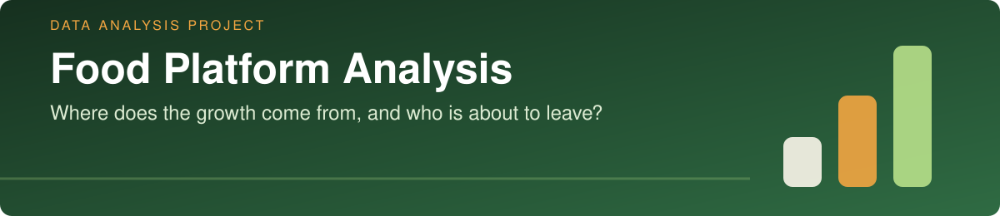
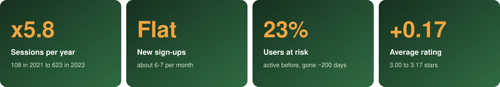
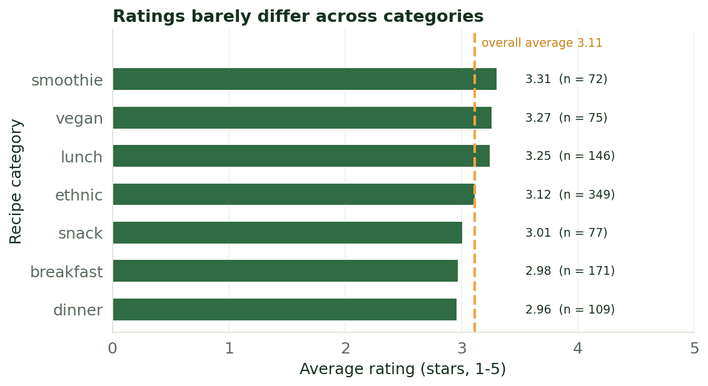
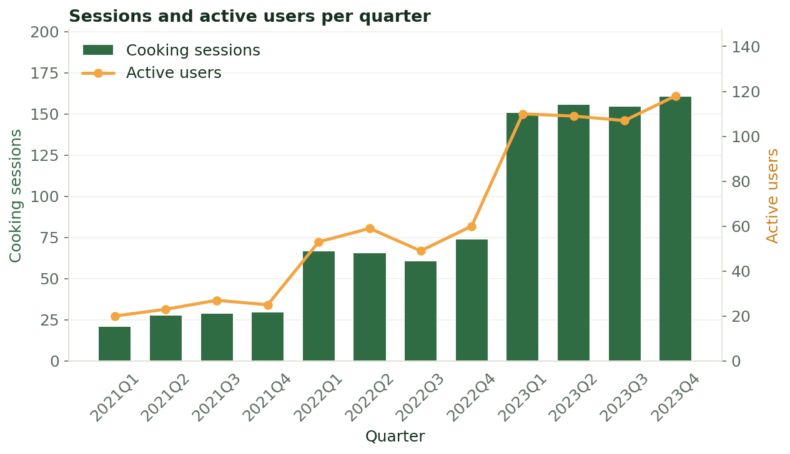
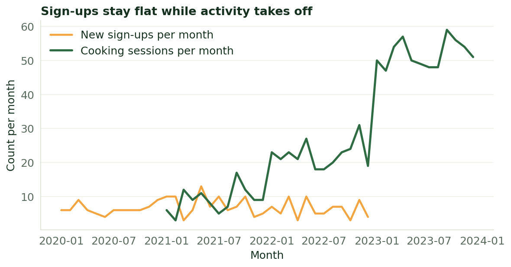
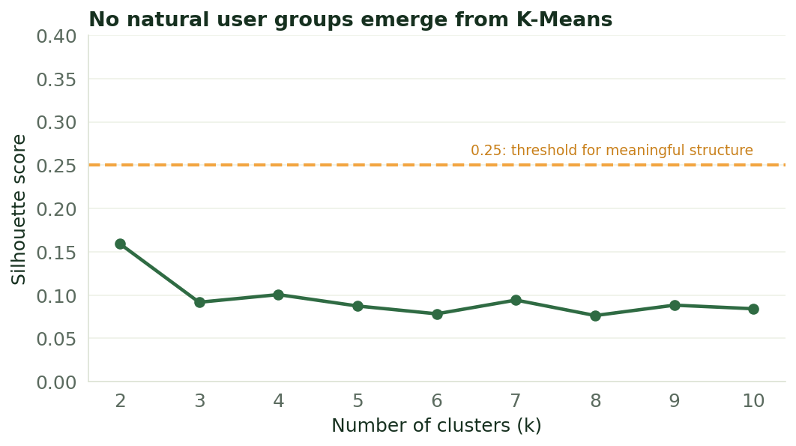
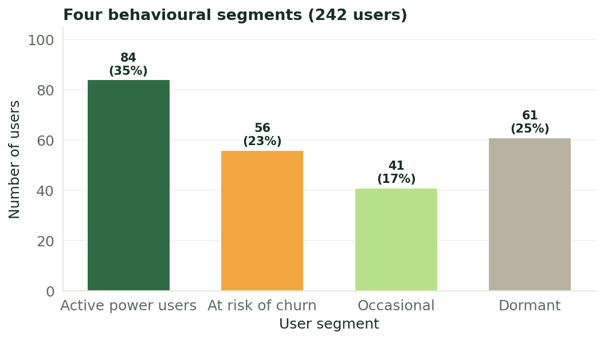
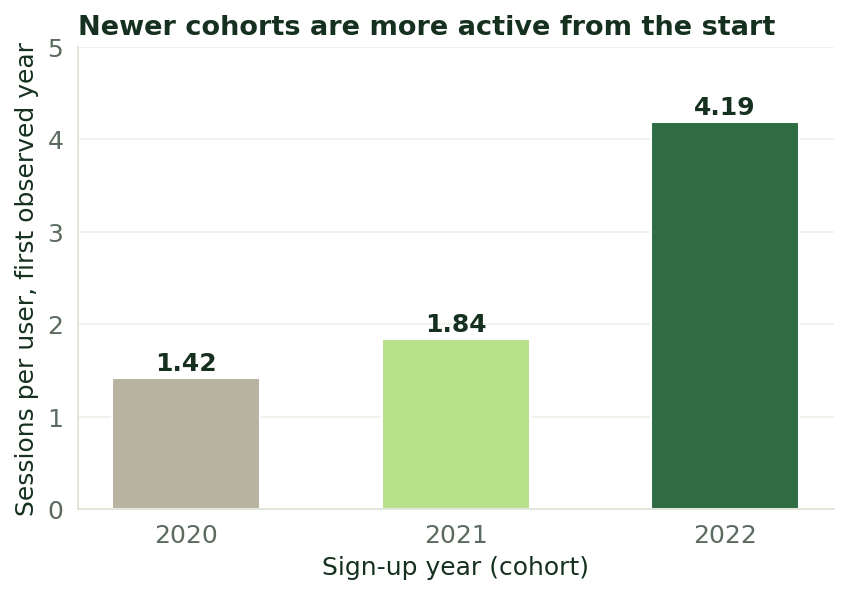
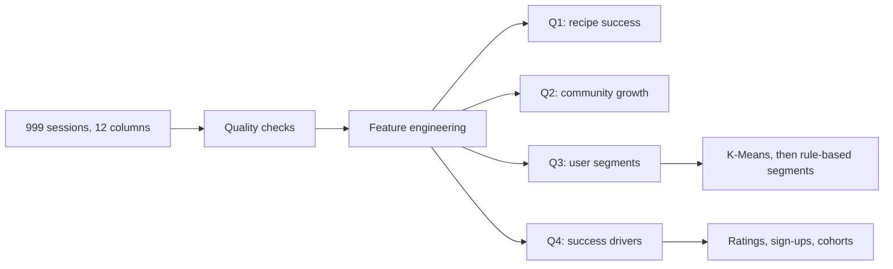

<p align="center">
  
</p>

<p align="center">
  
  
  
  
  
</p>

# Food Platform Analysis: where does the growth come from, and who is about to leave?

<p align="center">
  <a href="#project-background">Background</a> ·
  <a href="#key-metrics">Key Metrics</a> ·
  <a href="#executive-summary">Executive Summary</a> ·
  <a href="#insights-deep-dive">Insights</a> ·
  <a href="#recommendations">Recommendations</a> ·
  <a href="#limitations">Limitations</a> ·
  <a href="#repository--how-to-run">How to Run</a>
</p>

> **In one sentence:** the platform's activity grew almost **six-fold in three years** while new sign-ups stayed **flat**, so growth comes from existing users cooking more, not from more users joining. **23% of users** used to be as active as the best ones but have gone quiet for about 200 days, which makes them the best group to win back.

<br>


## Project Background

The dataset records cooking sessions on a recipe platform: which user cooked which recipe, when, on which device, and how many stars (1-5) they gave it, along with details about the recipe, the chef and the user's sign-up date. It covers **999 sessions from 242 users** in three countries (Italy, the UK and France), with sessions from January 2021 to December 2023 and sign-ups from 2020 to 2022. There are no missing values or duplicate rows.

The goal is to give the team what it needs to plan next year's strategy. The analysis answers four questions:

1. **Which recipes work best**, in terms of both volume and quality?
2. **Is the community growing?**
3. **Which groups of users exist**, and how do they behave?
4. **What drives the platform's success**, so that effort goes where it matters?

<br>


## Key Metrics



<br>


## Executive Summary

| Question | Short answer |
|---|---|
| **1. Which recipes work best?** | Ethnic recipes are cooked the most (35% of sessions). Ratings are similar everywhere (2.96-3.31 stars), and the best-rated combinations rest on small samples. |
| **2. Is the community growing?** | Yes, in activity: sessions rose from 108 (2021) to 623 (2023) and active users from 62 to 216. New sign-ups did not grow. |
| **3. Which groups of users exist?** | No natural groups. Four simple behavioural segments work well instead, and **56 users (23%) are at risk of churn**. |
| **4. What drives success?** | Not the content: category, chef and device barely change ratings. Growth comes from existing users becoming more active, and newer cohorts activate much faster. |

**What this means**

- **Growth is an engagement story, not an acquisition story.** Sign-ups are flat at about 6-7 a month, while monthly sessions went from 6-17 in 2021 to around 50 in 2023.
- **Changing the catalogue is unlikely to be the main lever.** Ratings hold steady across categories, devices and difficulty levels.
- **The most valuable group to act on is the "at risk" segment:** users who cooked as much as the best users but have been absent for about 200 days.

> [!NOTE]
> The dataset has no revenue, marketing or churn-reason fields. The conclusions are descriptive and show **where to look**, not what causes what.

<br>


## Insights Deep-Dive

### 1. Which recipes work best?

<p align="center">
  
</p>

- **Ethnic recipes dominate by volume** (349 of 999 sessions, 35%), followed by breakfast (171) and lunch (146).
- **Ratings are close everywhere:** from 2.96 stars (dinner) to 3.31 (smoothie), around an overall average of 3.11.
- **The highest-rated combinations** of category and difficulty are vegan-intermediate (3.77, 13 sessions), lunch-intermediate (3.56, 36 sessions), smoothie-basic (3.52, 25 sessions) and snack-basic (3.44, 27 sessions).
- **Intermediate recipes** get the best average rating (3.16) but are the least cooked (201 sessions, against 450 advanced and 348 basic).
- **Handle with care:** each recipe was cooked only 4-7 times at best, and several of the top combinations rest on a few dozen sessions, so these gaps are small and could easily be noise.

### 2. Is the community growing?

<p align="center">
  
</p>

| Year | Active users | Cooking sessions | Average rating |
|---|:---:|:---:|:---:|
| 2021 | 62 | 108 | 3.00 |
| 2022 | 131 | 268 | 3.02 |
| 2023 | 216 | 623 | 3.17 |

Activity and active users grew year after year, sessions per active user rose from about 1.05 to about 1.4 over the period, and satisfaction crept up slowly. Over the same time **sign-ups did not grow**: 76 in 2020, 91 in 2021 and 75 in 2022.

<p align="center">
  
</p>

### 3. Which groups of users exist?

First, a standard clustering method (K-Means) was tried on nine behaviour measures plus category, device and difficulty shares. It found **no natural groups**: the silhouette score never goes above 0.16, below the 0.25 level that indicates meaningful structure. A 2-dimensional view confirms it: users form a single continuous cloud, varying mainly in how intensely they use the platform and for how long.

<p align="center">
  
</p>

Since there are no natural clusters, four **behavioural segments** were built from two simple rules, using the median as the cut-off: how many recipes the user cooked (4 or more counts as high) and how recently they were active (within 94 days counts as recent).

<p align="center">
  
</p>

| Segment | Users | Share | Avg. recipes cooked | Days since last session | Avg. rating |
|---|:---:|:---:|:---:|:---:|:---:|
| **Active power users** | 84 | 35% | 5.7 | 41 | 3.1 |
| **At risk of churn** | 56 | 23% | 5.2 | 199 | 3.3 |
| **Occasional** | 41 | 17% | 2.5 | 46 | 3.2 |
| **Dormant** | 61 | 25% | 2.1 | 378 | 2.9 |

- **Active power users** are the healthy core.
- **At risk of churn** were just as active as the power users but have been silent for about 200 days. Priority target for a win-back campaign.
- **Occasional** users cook little but did so recently. They have been subscribed for about 2.2 years on average, so "occasional" describes their activity, not a recent arrival.
- **Dormant** users cooked little and have been gone for about a year, with the lowest ratings: probably lost.

### 4. What drives the platform's success?

The dataset has no revenue or conversion figures, so success was measured through four proxies: growth (new users), engagement (sessions), satisfaction (stars) and retention (the segments above).

**Satisfaction does not depend on content.** Average ratings are 3.10-3.14 across devices and 3.07-3.16 across difficulty levels, and challenge participation is practically unrelated to how much a user cooks (correlation 0.03). Chefs range from 2.83 to 3.56 stars, but each has only 33-59 sessions, a spread that is consistent with chance and needs more data to confirm.

**Growth comes from existing users, and newer cohorts activate faster.** Sign-ups have been flat, while sessions per user in the first observed year rise sharply with each sign-up cohort:

<p align="center">
  
</p>

The jump for the 2022 cohort partly coincides with a general increase in activity across all cohorts that year, so it cannot be fully isolated as a cohort effect. Also, no cohort has any activity in its own sign-up year (the first session always falls in the following year), which may reflect how the data was generated rather than real behaviour.

<details>
<summary><b>How the analysis was built (technical details)</b></summary>

<br>



- **Quality checks:** no exact duplicates, no missing values, language and country are consistent, and no session happens before the user's sign-up date.
- **Recipe success score:** equal weights on volume and average rating, both rescaled between 0 and 1. It is unstable here, because the best recipes have only 4-7 sessions.
- **User profile:** sessions aggregated per user (recipes, categories, chefs, rating, recency, tenure, activity span, challenges) plus category, device and level shares, standardized before clustering.
- **Clustering:** K-Means for k = 2 to 10 with elbow and silhouette; PCA (46% and 16% of the variance) for the visual check.
- **Segments:** high or low frequency and recent or not, split at the median (4 recipes and 94 days).

</details>

<br>


## Recommendations

1. **Win back the "at risk" segment first.** 56 users who were as active as the best ones and have been silent for about 200 days. This is a better bet than chasing dormant users who left almost a year ago.
2. **Find out what improved onboarding.** Newer cohorts become active much faster than older ones. Understanding why (with product data that is not in this dataset) and applying it to new users is the most promising growth lever.
3. **Look at acquisition and onboarding before changing the catalogue.** Content shows no clear link to ratings or activity, while sign-ups have been flat. This is a hypothesis to test, not a proven effect.
4. **Collect the missing data.** Acquisition channel, marketing spend, reasons for leaving and revenue would turn these descriptive findings into decisions with a measurable return.

<br>


## Limitations

- **Descriptive, not causal.** No acquisition, spend or churn-reason data, so the findings point to where to look, not to why.
- **Small samples.** About 4 sessions per user on average; the best recipes were cooked only 4-7 times, and chef comparisons rest on 33-59 sessions each.
- **No statistical tests** were run on the rating differences. They are judged as small by comparing averages and sample sizes.
- **Arbitrary segment cut-offs.** The median thresholds are a practical choice, not a natural boundary.
- **Data artefacts.** Sessions only start in 2021 and the first session always falls in the year after sign-up, which limits cohort comparisons.

<br>


## Repository & How to Run

```
food-platform-analysis/
├── data/
│   └── Food_data_Final_Project.xlsx
├── notebooks/
│   └── Food_Platform_Analysis.ipynb   # full analysis, executed, with outputs
├── images/                            # figures and graphics used in this README
├── requirements.txt
├── LICENSE
└── README.md
```

```bash
git clone https://github.com/YOUR-USERNAME/food-platform-analysis.git
cd food-platform-analysis

python -m venv .venv
source .venv/bin/activate          # Windows: .venv\Scripts\activate
pip install -r requirements.txt

jupyter notebook notebooks/Food_Platform_Analysis.ipynb
```

The notebook runs in a few seconds.

## About the Author

**Alessandro Cucchi**, data analyst. I turn raw data into clear answers and explain them to the people who decide.

[](https://www.linkedin.com/in/YOUR-LINKEDIN/)
[](https://github.com/YOUR-USERNAME)
